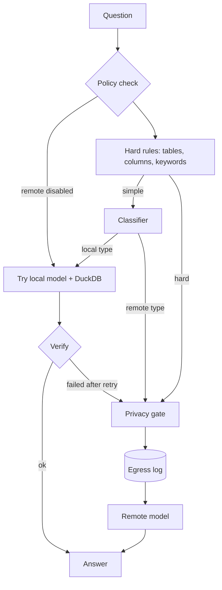

# Architecture

## Flow of one question

question -> policy check -> rules -> classifier -> try local -> verify -> (escalate through the privacy gate) -> answer.

## Two data paths

- **Tables** (CSV, XLSX, Parquet): registered as read-only DuckDB views named `t_<alias>`. SQL runs locally behind a guard.
- **Documents** (PDF, PPTX): text is extracted locally, split into chunks and searched with a keyword (BM25-style) index.

## Privacy gate and egress log

Only the privacy gate may build anything sent to the remote model, and only the gate may construct the remote adapter (enforced by a lint rule). Before any send, the gate writes an egress record (what, how much, a hash of the payload) and, if enabled, asks the user to confirm. Whole files are never sent; tables send capped rows or summaries, documents send the question plus the top chunks.

## Layer rule

`core` has no Electron, no DuckDB, no HTTP. It defines domain types, config and ports (interfaces). Adapters in `engine`, `models` and `docs` implement the ports. `agent` wires them together.

## Portability

The agent is exposed through one `AgentContract` interface (defined in Phase 3): `card()`, `ask()` streaming `TurnEvent`s, and `confirm()`. A host (the CLI now, the Electron app in Phase 5, another Electron host later) only needs that contract.
